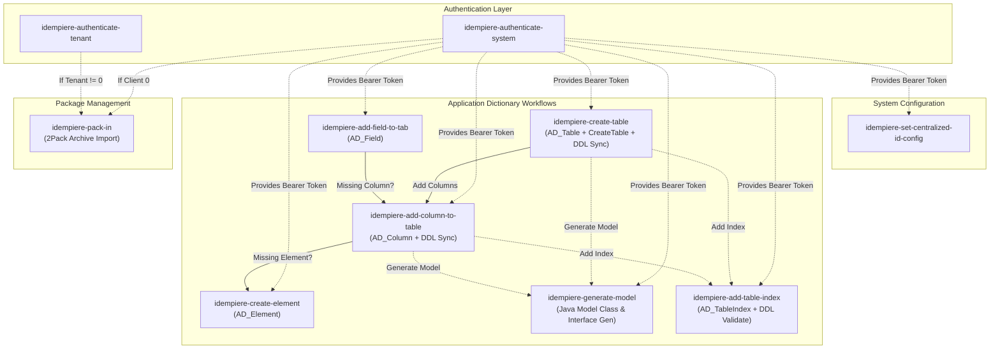
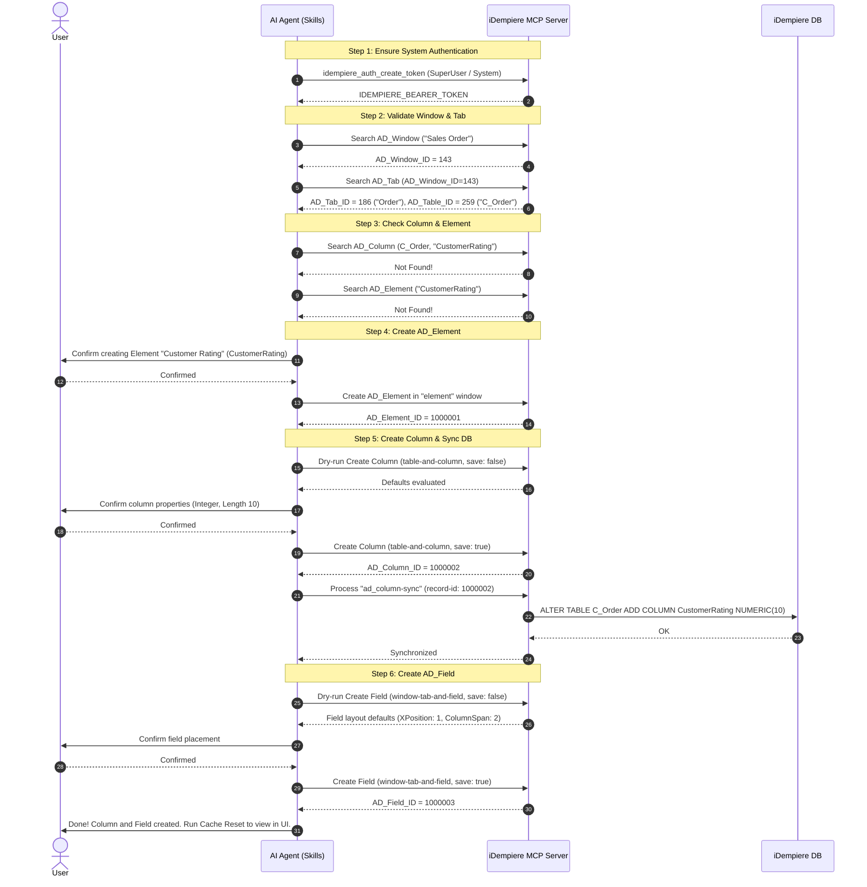

# iDempiere MCP Skills Documentation

This document provides a comprehensive technical guide and reference for the skills located in the [`skills`](./) folder. These skills enable AI coding assistants (such as Google Antigravity, Claude, or custom MCP agents) to interact systematically with [iDempiere ERP](https://www.idempiere.org/) via the [Model Context Protocol (MCP)](https://modelcontextprotocol.io/).

---

## Table of Contents

1. [Overview](#overview)
2. [Skill Catalog & Summary](#skill-catalog--summary)
3. [Architecture & Interaction Workflow](#architecture--interaction-workflow)
4. [Prerequisites & Authentication](#prerequisites--authentication)
5. [Common Options & Conventions](#common-options--conventions)
6. [Detailed Skill Reference](#detailed-skill-reference)
   - [1. `idempiere-authenticate-system`](#1-idempiere-authenticate-system)
   - [2. `idempiere-authenticate-tenant`](#2-idempiere-authenticate-tenant)
   - [3. `idempiere-create-table`](#3-idempiere-create-table)
   - [4. `idempiere-create-element`](#4-idempiere-create-element)
   - [5. `idempiere-add-column-to-table`](#5-idempiere-add-column-to-table)
   - [6. `idempiere-add-field-to-tab`](#6-idempiere-add-field-to-tab)
   - [7. `idempiere-pack-in`](#7-idempiere-pack-in)
   - [8. `idempiere-set-centralized-id-config`](#8-idempiere-set-centralized-id-config)
   - [9. `idempiere-generate-model`](#9-idempiere-generate-model)
   - [10. `idempiere-add-table-index`](#10-idempiere-add-table-index)
7. [Composite Workflows & Orchestration](#composite-workflows--orchestration)
8. [Error Handling & Best Practices](#error-handling--best-practices)

---

## Overview

The iDempiere MCP skills provide guided, deterministic procedures for critical Application Dictionary (AD) maintenance and administration tasks:
- **Authentication**: Managing JWT bearer tokens across System (Tenant 0) and application tenant contexts.
- **Application Dictionary (AD) Engineering**: Creating database tables (with standard columns, optional `_Trl` translation tables, and key/unique indexes), creating data elements, adding database columns, synchronizing physical schemas, generating Java model classes, and placing fields on UI window tabs.
- **Package Management**: Importing 2Pack archives (`PackIn`) with attachment handling and client targeting validation.
- **System Configuration**: Configuring centralized sequence IDs and dictionary developer credentials.

---

## Skill Catalog & Summary

| Skill | Directory | Primary Scope | Target Object / Endpoint | Auth Scope |
|---|---|---|---|---|
| [`idempiere-authenticate-system`](./idempiere-authenticate-system/SKILL.md) | `skills/idempiere-authenticate-system` | System Admin Auth | `idempiere_auth_create_token` | System (`Client 0`) |
| [`idempiere-authenticate-tenant`](./idempiere-authenticate-tenant/SKILL.md) | `skills/idempiere-authenticate-tenant` | Tenant / Business Auth | `idempiere_auth_create_token` | Tenant (e.g. GardenWorld) |
| [`idempiere-create-table`](./idempiere-create-table/SKILL.md) | `skills/idempiere-create-table` | Table Definition & DDL | `AD_Table`, `createtable`, `ad_column-sync`, `ad_tableindex-validate` | System Admin |
| [`idempiere-create-element`](./idempiere-create-element/SKILL.md) | `skills/idempiere-create-element` | Element Definition | `AD_Element` / `element` window | System Admin |
| [`idempiere-add-column-to-table`](./idempiere-add-column-to-table/SKILL.md) | `skills/idempiere-add-column-to-table` | Table Column & DDL | `AD_Column`, `ad_column-sync` | System Admin |
| [`idempiere-add-field-to-tab`](./idempiere-add-field-to-tab/SKILL.md) | `skills/idempiere-add-field-to-tab` | UI Window Tab Field | `AD_Field` / `window-tab-and-field` | System Admin |
| [`idempiere-pack-in`](./idempiere-pack-in/SKILL.md) | `skills/idempiere-pack-in` | 2Pack Zip Import | `AD_Package_Imp_Proc`, `PackIn` | System or Tenant |
| [`idempiere-set-centralized-id-config`](./idempiere-set-centralized-id-config/SKILL.md) | `skills/idempiere-set-centralized-id-config` | SysConfig Credentials | `AD_SysConfig` | System Admin |
| [`idempiere-generate-model`](./idempiere-generate-model/SKILL.md) | `skills/idempiere-generate-model` | Java Model Generation | `AD_Table`, `generatemodel` | System Admin |
| [`idempiere-add-table-index`](./idempiere-add-table-index/SKILL.md) | `skills/idempiere-add-table-index` | Table Index Definition & DDL | `AD_TableIndex`, `ad_tableindex-validate` | System Admin |

---

## Architecture & Interaction Workflow

The skills are modular and frequently chain together. For example, creating a new table sets up the base `AD_Table` metadata, standard columns, physical DDL, and indexes before custom business columns are added via `idempiere-add-column-to-table`; similarly, adding a UI field to a window tab can trigger adding a table column, which in turn can trigger creating a missing element.



---

## Prerequisites & Authentication

All non-login MCP tool invocations require authentication.
- **Bearer Token**: The JWT token returned by `idempiere_auth_create_token` must be stored as `IDEMPIERE_BEARER_TOKEN`.
- **Authorization Parameter**: Pass the raw JWT string without the `Bearer ` prefix via the `_authorization_bearer` argument:
  ```json
  {
    "_authorization_bearer": "<IDEMPIERE_BEARER_TOKEN>"
  }
  ```
  *(If the MCP client injects `Authorization: Bearer <token>` in the HTTP headers, the header takes precedence.)*
- **Token Invalidation / Expiration**: When any tool returns a `401 Unauthorized` or token expired error, re-execute the appropriate authentication skill.

---

## Common Options & Conventions

Many Application Dictionary manipulation skills (`idempiere-create-table`, `idempiere-create-element`, `idempiere-add-column-to-table`, `idempiere-add-field-to-tab`, `idempiere-pack-in`) share the following optional parameters:

| Parameter | Type | Default | Description |
|---|---|---|---|
| `logMigrationScript` | `boolean` | `false` | When `true`, instructs iDempiere to log SQL migration scripts on the server. |
| `adempiereSys` | `boolean` | `false` | Dictionary maintenance mode (`EntityType = 'D'`). Requires centralized dictionary IDs. |
| `migrationScriptComment` | `string` | `""` | Documentation comment logged with the migration script (e.g., ticket ID and feature summary). |

### Field & Naming Conventions
- Table names follow the `Prefix_CamelCase` convention (e.g. `XX_CustomerFeedback`, `C_Order`) with a 60-character limit on `AD_Table.TableName` and a 63-character database object identifier limit on derived constraints and indexes.
- `Is*` columns are standard `Y`/`N` checkboxes/booleans (e.g. `IsActive`, `IsMandatory`, `IsDisplayed`).
- `*_ID` columns represent primary or foreign keys (e.g. `AD_Element_ID`, `AD_Column_ID`, `AD_Table_ID`).
- `*_UU` columns store record UUIDs (e.g. `$TableName_UU`).
- CamelCase naming is standard for multi-word elements and columns (`CustomerFeedback`, `WhereClause`).

---

## Detailed Skill Reference

---

### 1. `idempiere-authenticate-system`
*File: [`skills/idempiere-authenticate-system/SKILL.md`](./idempiere-authenticate-system/SKILL.md)*

#### Purpose
Authenticates as the System Administrator in Tenant 0 (`Client 0`). Required for Application Dictionary updates, centralized dictionary configuration, and System-level 2Pack imports.

#### Environment Variables & Defaults
| Parameter | Env Variable | Default Value | Notes |
|---|---|---|---|
| `userName` | `IDEMPIERE_ADMINISTRATOR_USER` | `SuperUser` | System user |
| `password` | `IDEMPIERE_ADMINISTRATOR_PASS` | `System` | System user password |
| `roleId` | `IDEMPIERE_ADMINISTRATOR_ROLE` | `0` | System Administrator role ID or Name |
| `clientId` | — | `"0"` | Hardcoded to System client (`"0"`) |
| `organizationId` | — | `"0"` | Hardcoded to `*` organization (`"0"`) |
| `language` | — | `"en_US"` | Default locale |

> **Security Note**: Never print or echo raw passwords or tokens into chat transcripts.

#### MCP Tools Used
- `idempiere_auth_create_token`: Authenticates credentials and returns a JWT token.
- `idempiere_auth_update_token`: Switches role/organization without full re-authentication.
- `idempiere_auth_logout`: Terminates the session.

#### Execution Flow
1. Check if an existing valid token is cached; reuse it if valid.
2. Resolve login variables from environment (treating empty strings as unset).
3. Call `idempiere_auth_create_token`:
   ```json
   {
     "userName": "SuperUser",
     "password": "...",
     "parameters": {
       "clientId": "0",
       "roleId": "0",
       "organizationId": "0",
       "language": "en_US"
     }
   }
   ```
4. Extract `response.token` (never `refresh_token`) and set as `IDEMPIERE_BEARER_TOKEN`.
5. On failure, halt and display the exact error message. Never guess credentials.

---

### 2. `idempiere-authenticate-tenant`
*File: [`skills/idempiere-authenticate-tenant/SKILL.md`](./idempiere-authenticate-tenant/SKILL.md)*

#### Purpose
Authenticates into an application tenant (e.g., GardenWorld) for transactional data operations, tenant-specific model searches, and tenant-level 2Pack imports.

#### Environment Variables & Defaults
| Parameter | Env Variable | Default Value | Notes |
|---|---|---|---|
| `userName` | `IDEMPIERE_TENANT_USER` | `GardenAdmin` | Tenant username |
| `password` | `IDEMPIERE_TENANT_PASS` | `GardenAdmin` | Tenant password |
| `clientId` | `IDEMPIERE_TENANT` | `GardenWorld` | Tenant ID or search key |
| `roleId` | `IDEMPIERE_TENANT_ROLE` | `GardenWorld Admin` | Role ID or Name |
| `organizationId` | `IDEMPIERE_TENANT_ORG` | `"0"` | Default `*` organization |
| `warehouseId` | `IDEMPIERE_TENANT_WAREHOUSE` | `"0"` | `"0"` means no specific warehouse |

#### MCP Tools Used
- `idempiere_auth_create_token`: Generates tenant-scoped JWT token.
- `idempiere_auth_update_token`: Modifies tenant session context.
- `idempiere_auth_logout`: Closes session.

#### Execution Flow
1. Resolve environment variables and defaults.
2. Call `idempiere_auth_create_token` passing `clientId`, `roleId`, `organizationId`, and `warehouseId` as strings.
3. Save `response.token` as `IDEMPIERE_BEARER_TOKEN`.

---

### 3. `idempiere-create-table`
*File: [`skills/idempiere-create-table/SKILL.md`](./idempiere-create-table/SKILL.md)*

#### Purpose
Creates a new physical table definition in iDempiere (`AD_Table`, `IsView = false` only) using the `Table and Column` window (`table-and-column`), validates table identifier syntax/length, naming convention, and case-insensitive uniqueness, executes the `CreateTable` process to generate standard columns, synchronizes physical database DDL via `ad_column-sync` (including optional `_Trl` translation table), reconciles UUID key index metadata when applicable, and validates key indexes plus standard unique indexes on `Value` (and on `DocumentNo` only when `C_DocType_ID` is also present).

#### Inputs
- **Mandatory**:
  - `TableName`: Database table name (`^[A-Za-z][A-Za-z0-9_]*$`, max 60 chars per `AD_Table.TableName VARCHAR(60)`, e.g., `XX_CustomerFeedback`; `Prefix_CamelCase` guideline). Derived database identifiers (`_Value` max 57, `_UU_idx` / `_Trl_UU` max 56, `_Trl_pkey` max 54, `_DocumentNo` max 52) must stay within the 63-char database object name limit.
  - `AccessLevel`: Data Access Level 1-character string code (user-provided names or aliases are normalized to `"4"` System only, `"6"` System+Client, `"3"` Client+Organization, `"2"` Client only, `"1"` Organization, `"7"` All; never send display labels or `{"identifier": "..."}` in REST payloads).
  - `Name`: Human-readable table name shown to users (e.g., `Customer Feedback`).
- **Other & Optional**:
  - `TableKeyType`: Primary key type — `ID Key Table` (default: numeric `<TableName>_ID` PK + `<TableName>_UU` UUID) or `UUID Key Table` (`<TableName>_UU` PK only).
  - `CreateTable` generation flags (`"Y"`/`"N"` strings):
    - Common entity columns (default `"Y"`): `IsCreateColValue`, `IsCreateColName`, `IsCreateColDescription`, `IsCreateColHelp`.
    - Optional features & document columns (default `"N"`): `IsCreateColDocumentNo`, `IsCreateTranslationTable` (creates `<TableName>_Trl`), `IsCreateWorkflow` (also creates `AD_Workflow` + `AD_Process` and links `DocAction`), and transactional flags (`IsCreateColDocAction`, `IsCreateColDocStatus`, `IsCreateColProcessed`, `IsCreateColProcessedOn`, `IsCreateColProcessing`, `IsCreateColC_DocTypeTarget_ID`, `IsCreateColC_DocType_ID`, `IsCreateColC_Currency_ID`, `IsCreateColDateTrx`, `IsCreateColDateAcct`, `IsCreateColPosted`, `IsCreateColIsApproved`, `IsCreateColSalesRep_ID`, `IsCreateColAD_User_ID`).
  - `logMigrationScript`: Log SQL migration script on server (`true`/`false`, omitted when unused and never sent during `save: false`).
  - `adempiereSys`: Dictionary maintenance mode (`EntityType = 'D'`, requires centralized ID config via `idempiere-set-centralized-id-config`).
  - `migrationScriptComment`: Migration script comment (only passed when `logMigrationScript` is `true` and non-empty; never `""`).
  - Optional `AD_Table` fields: `Description`, `Help`, `EntityType`, `IsSecurityEnabled`, `IsDeleteable`, `IsChangeLog`, `IsHighVolume`, `IsCentrallyMaintained` (`IsView = true` is rejected).

#### MCP Tools Used
- `idempiere_model_search_records`: Checks `AD_Table` case-insensitively for duplicates (and `_Trl` tables), fetches generated `AD_Column` records (`limit: 100`) in a single query, and queries `AD_TableIndex` for key/business index reconciliation and duplicate checks.
- `idempiere_window_create_record`: Creates `AD_Table` record in `table-and-column` (dry-run `save: false` to evaluate defaults/callouts, then persist `save: true`).
- `idempiere_process_get_info`: *(Optional)* Inspects full `createtable` parameter metadata when configuring transactional/document columns.
- `idempiere_process_run`:
  - `createtable`: Generates standard audit columns (`AD_Client_ID`, `AD_Org_ID`, `Created`, `CreatedBy`, `Updated`, `UpdatedBy`, `IsActive`, `<TableName>_UU`, and `<TableName>_ID` if ID key table) plus selected business/document columns and optional `_Trl` table. Must receive `TableName`, `Name`, `AccessLevel`, `Description` (if supplied), and `EntityType` explicitly — REST does not evaluate client-side `@TableName@`-style parameter defaults.
  - `ad_column-sync`: Executes DDL (`CREATE TABLE`) in PostgreSQL/Oracle for the main table (and `<TableName>_Trl` when `IsCreateTranslationTable = "Y"`).
  - `ad_tableindex-validate`: Validates and creates physical database key/unique indexes, including `<TableName>_UU_idx` (UUID key), `<TableName>_Trl_pkey` (translation table PK), `<TableName>_Value`, and `<TableName>_DocumentNo`.
- `idempiere_model_update_record`: For `UUID Key Table`, updates `AD_TableIndex` (`<TableName>_UU_idx`) to set `IsKey: false` so validation creates a physical `UNIQUE` constraint rather than conflicting with the `<TableName>_Key` primary key.
- `idempiere_window_create_child_tab_record`: Creates child table index (`table-index`) with nested index columns (`index-column`).
- `idempiere_cache_reset`: *(Optional)* Resets Application Dictionary cache when immediate UI visibility is needed.

#### Step-by-Step Workflow
1. **Validate `TableName`**:
   - Validate character safety (`^[A-Za-z][A-Za-z0-9_]*$`) and length (`<= 60` chars; warn if `> 52` chars and block features whose derived identifiers exceed 63 chars) *before* OData interpolation.
   - Check `Prefix_CamelCase` convention (`^[A-Z][A-Z0-9]*_[A-Z][A-Za-z0-9]*$`); warn and wait for confirmation if non-conforming (legitimate names may contain extra underscores or digit-led segments, e.g., `T_1099Extract`, `C_BankAccount_Acct`).
   - Check uniqueness case-insensitively via `AD_Table` filter `tolower(TableName) eq '<lowercase_tablename>'`. Stop if found, unless resuming an interrupted run of this skill for the same table from the first incomplete step.
2. **Create `AD_Table` Record (Dry-Run, Confirm & Persist)**:
   - Normalize `AccessLevel` to its 1-char string code; omit `EntityType` unless user-supplied so the window evaluates its default (`adempiereSys: true` passed on dry-run if requested; omit `logMigrationScript`/`migrationScriptComment` during `save: false`).
   - Call `idempiere_window_create_record` (`window_name: "table-and-column"`, `save: false`), display evaluated values (including mandatory `IsView` and `IsSecurityEnabled`), confirm with user, then persist with `save: true` using scalar codes/IDs (omitting read-only `AD_Client_ID`/`AD_Org_ID`) and retain `AD_Table_ID` and `TableEntityType`.
3. **Generate Standard Columns & Fetch Column Metadata**:
   - When `IsCreateTranslationTable = "Y"`, first verify `<TableName>_Trl` does not already exist in `AD_Table` (CreateTable would silently reuse it) and `<TableName>_Trl_pkey` fits within 63 chars. Confirm `IsCreateWorkflow = "Y"` side effects (`AD_Workflow` + `AD_Process` creation) before enabling.
   - Execute `createtable` (`record_id: <AD_Table_ID>` as integer) passing `TableName`, `Name`, `AccessLevel`, `Description`, and `EntityType: "<TableEntityType>"` explicitly, plus `IsCreateKeyColumn: "Y"` (ID Key) or `"N"` (UUID Key) and `"Y"`/`"N"` column flags. Verify `response.isError !== true`.
   - Query `AD_Column` once (`AD_Table_ID eq <AD_Table_ID>`, `limit: 100`, paging if `> 100`) and cache records; always select columns by `ColumnName`, never by array position (`records[0]`).
4. **Update Database (Synchronize Physical Table DDL)**:
   - Must execute *before* index validation. Run `ad_column-sync` (`record_id: <AD_Column_ID>` as integer, selected by `<TableName>_ID` or `<TableName>_UU` column name; `DateFrom: "1970-01-01"` may be passed to sync all columns if an orphan table existed) and verify `response.isError !== true`.
   - If `IsCreateTranslationTable = "Y"`, resolve `<TableName>_Trl` and its `AD_Language` column, then synchronize `<TableName>_Trl` via `ad_column-sync`.
   - For `UUID Key Table`, search `AD_TableIndex` for `<TableName>_UU_idx`, confirm with user, and update `IsKey` to `false` to reconcile dictionary metadata with the physical `<TableName>_Key` primary key.
5. **Create and Validate Table Indexes**:
   - First validate key indexes via `ad_tableindex-validate`: `<TableName>_UU_idx` for UUID key tables (creates `UNIQUE` constraint) and `<TableName>_Trl_pkey` for translation tables (creates `_Trl` primary key).
   - If `Value` exists in the cached `AD_Column` list, confirm, create, and validate `<TableName>_Value` (`IsUnique: true` on `AD_Client_ID` + `Value`, or `Value` alone for `AccessLevel = "4"`).
   - Only if **both** `DocumentNo` and `C_DocType_ID` exist, confirm, create, and validate `<TableName>_DocumentNo` (`IsUnique: true` on `AD_Client_ID`, `DocumentNo`, `C_DocType_ID`, omitting `AD_Client_ID` for `AccessLevel = "4"`). If `DocumentNo` exists without `C_DocType_ID`, skip the index and explain why.
   - For each business index, invoke the [`idempiere-add-table-index`](#10-idempiere-add-table-index) skill with `AD_Table_ID`, derived index name (`<= 63` chars), `IsUnique: true`, and the column list.
6. **Report Summary & Next Steps**:
   - Display created table(s), `AD_Table_ID`(s), access level, entity type, key type, generated columns, DDL sync status, and validated/skipped indexes (never echoing `IDEMPIERE_BEARER_TOKEN`), and suggest `idempiere-add-column-to-table` for custom columns/model generation or `idempiere_cache_reset`.

---

### 4. `idempiere-create-element`
*File: [`skills/idempiere-create-element/SKILL.md`](./idempiere-create-element/SKILL.md)*

#### Purpose
Creates a new reusable metadata element (`AD_Element`) in iDempiere's **Element** window (`element`). Checks for existing elements before creation to avoid duplicate dictionary entries.

#### Inputs
| Property | JSON Field | Mandatory | Description |
|---|---|---|---|
| Name | `Name` | **Yes** | Display label shown to users (e.g., `Customer Feedback`). Must be provided by user. |
| Column Name | `ColumnName` | **Yes** | Physical DB column name (e.g., `XX_CustomerFeedback`). Must be provided by user. |
| Print Name | `PrintName` | No | Short label for reports (defaults to `Name`). |
| Description | `Description` | No | Short descriptive text. |
| Help | `Help` | No | Detailed help text. |
| Entity Type | `EntityType` | No | Entity module type (e.g., `U` for User). |

#### MCP Tools Used
- `idempiere_window_get_records`: Searches existing elements in window `element`.
- `idempiere_window_create_record`: Creates the element in window `element`.

#### Step-by-Step Workflow
1. **Duplicate Check**:
   Query window `element` with filter:
   ```json
   {
     "_authorization_bearer": "<IDEMPIERE_BEARER_TOKEN>",
     "window_name": "element",
     "filter": "ColumnName eq '<ColumnName>'"
   }
   ```
2. **Halt if Exists**:
   If a matching record exists, output the existing record details (`AD_Element_ID`, `Name`, `ColumnName`, `EntityType`, `IsActive`) and stop immediately.
3. **Create Record**:
   If not found, prompt user for confirmation, then create:
   ```json
   {
     "_authorization_bearer": "<IDEMPIERE_BEARER_TOKEN>",
     "window_name": "element",
     "data": {
       "Name": "<Name>",
       "ColumnName": "<ColumnName>",
       "PrintName": "<PrintName>",
       "Description": "<Description>",
       "Help": "<Help>",
       "EntityType": "<EntityType>"
     }
   }
   ```
4. **Report Output**: Return `AD_Element_ID`, `Name`, and `ColumnName`.

---

### 5. `idempiere-add-column-to-table`
*File: [`skills/idempiere-add-column-to-table/SKILL.md`](./idempiere-add-column-to-table/SKILL.md)*

#### Purpose
Adds a new column definition (`AD_Column`) to an existing table, executes the physical database synchronization process (`ad_column-sync`), and optionally creates indexes and re-generates Java POJO model classes.

#### Inputs
- **Mandatory**:
  - `TableName`: Database table name (e.g., `C_Order`).
  - `ColumnName`: Database column name (e.g., `XX_CustomerFeedback`).
- **Common & Optional**:
  - `Reference`: Name of reference (`AD_Reference.Name`, e.g., `String`, `TableDir`, `Amount`, `Yes-No`).
  - `FieldLength`: Column length (e.g., `1`, `10`, `60`).
  - `DefaultValue`: Default SQL/literal value (e.g., `'N'`, `0`).
  - `AD_Reference_Value_ID`: Specific reference list or table validation rule.
  - `IsMandatory`, `IsIdentifier`, `IsSelectionColumn`, `Callout`, `EntityType`.

#### MCP Tools Used
- `idempiere_model_search_records`: Resolves `AD_Element` and `AD_Reference`.
- `idempiere_window_get_records`: Finds the parent table record in window `table-and-column`.
- `idempiere_window_create_child_tab_record`: Adds the child column record (supports dry-run `save: false` and persist `save: true`) and table index.
- `idempiere_process_run`:
  - `ad_column-sync`: Executes DDL to alter/create physical column in PostgreSQL/Oracle.
  - `ad_tableindex-validate`: Validates/creates physical database index.

#### Step-by-Step Workflow
1. **Resolve Element**:
   Search `AD_Element` by `ColumnName`. If not found, execute `idempiere-create-element` to create it.
2. **Resolve Reference**:
   Search `AD_Reference` by `Name eq '<Reference>'` to obtain `AD_Reference_ID`.
3. **Find Parent Table**:
   Search window `table-and-column` for `TableName eq '<TableName>'` to obtain `AD_Table_ID`.
4. **Dry-Run Column Creation (`save: false`)**:
   Call `idempiere_window_create_child_tab_record` with `tab_name: "table"`, `child_tab_name: "column"`, and `save: false`.
   > **Important**: Do NOT include `ColumnName` directly in `data` — it is derived from `AD_Element_ID`.
5. **Confirm and Persist (`save: true`)**:
   Display evaluated defaults and callouts to the user. Upon confirmation, execute save and capture `AD_Column_ID`.
6. **Synchronize Column (DDL)**:
   Invoke process `ad_column-sync` with `record-id: <AD_Column_ID>`. Halt if process returns an error.
7. **Optional Index**:
   If requested, invoke the [`idempiere-add-table-index`](#10-idempiere-add-table-index) skill to create and validate the table index.
8. **Optional Model Generation**:
   If requested, invoke the [`idempiere-generate-model`](#9-idempiere-generate-model) skill for `<TableName>`.

---

### 6. `idempiere-add-field-to-tab`
*File: [`skills/idempiere-add-field-to-tab/SKILL.md`](./idempiere-add-field-to-tab/SKILL.md)*

#### Purpose
Adds a visual field (`AD_Field`) to a window tab (`AD_Tab`) within the `Window, Tab & Field` window (`window-tab-and-field`).

#### Inputs
- **Mandatory**:
  - `WindowName`: Window name (`AD_Window.Name`, e.g., `Sales Order`).
  - `TabName` or `TabIndex`: Target tab name or 0-based tab index sorted by `SeqNo`.
  - `ColumnName`: Database column name (`AD_Column.ColumnName`).
- **Defaults**:
  - `XPosition`: `1` (Left column).
  - `ColumnSpan`: `2` (Full-width spanning 2 layout columns).
- **Optional**:
  - `SeqNo`, `SeqNoGrid`, `IsDisplayed`, `IsDisplayedGrid`, `IsReadOnly`, `IsSameLine`, `DisplayLogic`, `ReadOnlyLogic`, `MandatoryLogic`, `EntityType`.

#### MCP Tools Used
- `idempiere_model_search_records`: Resolves `AD_Window`, `AD_Tab`, `AD_Column`, and checks for existing `AD_Field`.
- `idempiere_model_get_record`: Looks up table identifier if adding a missing column.
- `idempiere_window_create_child_tab_record`:
  - `window_name`: `window-tab-and-field`
  - `tab_name`: `tab`
  - `child_tab_name`: `field`
  - Dry run with `save: false` followed by user confirmation and `save: true`.

#### Step-by-Step Workflow
1. **Validate Window**:
   Search `AD_Window` for `Name eq '<WindowName>' and IsActive eq true`. Escape any single quotes.
2. **Validate & Resolve Tab**:
   Search `AD_Tab` for `AD_Window_ID eq <AD_Window_ID> and IsActive eq true` with `limit: 100`.
   Sort results by `SeqNo` ascending. Resolve `TabName` or 0-based `TabIndex`. Extract `AD_Tab_ID` and `AD_Table_ID`.
3. **Validate Column**:
   Search `AD_Column` for `AD_Table_ID eq <AD_Table_ID> and ColumnName eq '<ColumnName>'`.
   - If missing, offer to invoke `idempiere-add-column-to-table`.
4. **Duplicate Field Check**:
   Search `AD_Field` for `AD_Tab_ID eq <AD_Tab_ID> and AD_Column_ID eq <AD_Column_ID>`. Halt if any record exists.
5. **Dry-Run Creation (`save: false`)**:
   Call `idempiere_window_create_child_tab_record` with `XPosition: 1`, `ColumnSpan: 2` (or user overrides). Show resulting field configuration to the user.
6. **Save Record (`save: true`)**:
   Merge writable values from dry-run response with user overrides (excluding read-only fields like `AD_Field_ID`). Persist the record.
7. **Cache Notification**:
   Remind user that the new field will appear in the web UI after resetting the iDempiere cache (`Cache Reset` process) or re-logging in.

---

### 7. `idempiere-pack-in`
*File: [`skills/idempiere-pack-in/SKILL.md`](./idempiere-pack-in/SKILL.md)*

#### Purpose
Imports a 2Pack packaging zip archive into iDempiere via the **Pack In** window (`pack-in`) and process (`PackIn`).

#### Inputs
- **Mandatory**:
  - `ArchiveFile`: Absolute path to the 2Pack zip file on disk (e.g., `/workspace/2Pack_1.0.0.zip`).
- **Optional Execution Options**:
  - `AD_Override_Dict`: Update system-maintained Application Dictionary (`true`/`false`, default `false`).
  - `logMigrationScript`, `adempiereSys`, `migrationScriptComment`.

#### MCP Tools Used
- `idempiere_model_create_record` (or window `pack-in`): Creates `AD_Package_Imp_Proc` tracking record.
- `idempiere_model_add_record_attachment`: Attaches local zip archive to `AD_Package_Imp_Proc`.
- `idempiere_process_run`: Runs the `PackIn` process (`record_id` must be an integer).
- `idempiere_model_search_records`: Queries `AD_Package_Imp` and `AD_Package_Imp_Detail` for post-import verification and troubleshooting.

#### Step-by-Step Workflow
1. **Archive Validation**:
   - Verify file existence on disk.
   - Run zip inspection to check for valid descriptor:
     ```bash
     unzip -Z1 "<ArchiveFile>" | grep -E "^[^/]+/dict/PackOut\.(xml|json|yaml)$"
     ```
   - Check `Client` attribute in `PackOut.*`:
     - If client starts with `0-`, require System tenant auth (`idempiere-authenticate-system`).
     - If non-zero client ID, require tenant auth (`idempiere-authenticate-tenant`).
2. **Create Package Import Record**:
   Create record in `AD_Package_Imp_Proc` with package name:
   ```json
   {
     "model": "AD_Package_Imp_Proc",
     "data": {
       "Name": "2Pack_1.0.0.zip",
       "AD_Override_Dict": false
     }
   }
   ```
   Capture `AD_Package_Imp_Proc_ID`.
3. **Upload Archive Attachment**:
   Call `idempiere_model_add_record_attachment`:
   ```json
   {
     "tableName": "AD_Package_Imp_Proc",
     "record_id": "<AD_Package_Imp_Proc_ID>",
     "data": "<ArchiveFile>"
   }
   ```
4. **Execute PackIn Process**:
   Call `idempiere_process_run`:
   ```json
   {
     "process_value": "PackIn",
     "record_id": <AD_Package_Imp_Proc_ID>
   }
   ```
5. **Verify Outcome**:
   Check `isError` flag and `summary` text. Note that HTTP 200 may still contain `isError: true` or unresolved counts (`Un-Resolved=...`). Query `AD_Package_Imp_Detail` if errors occurred.

---

### 8. `idempiere-set-centralized-id-config`
*File: [`skills/idempiere-set-centralized-id-config/SKILL.md`](./idempiere-set-centralized-id-config/SKILL.md)*

#### Purpose
Configures the official centralized sequence ID credentials in `AD_SysConfig` (`DICTIONARY_ID_USER` and `DICTIONARY_ID_PASSWORD`). Used by core developers and official plugin authors to avoid ID collisions across iDempiere versions.

#### Environment Variables
| Setting | Primary Variable | Fallback Variable | Description |
|---|---|---|---|
| Centralized ID User | `IDEMPIERE-CENTRALIZED-ID-USER` | `IDEMPIERE_CENTRALIZED_ID_USER` | Registered centralized ID username |
| Centralized ID Password | `IDEMPIERE-CENTRALIZED-ID-PASS` | `IDEMPIERE_CENTRALIZED_ID_PASS` | Centralized ID sequence password |

#### MCP Tools Used
- `idempiere_model_search_records`: Finds `AD_SysConfig` records for `DICTIONARY_ID_USER` and `DICTIONARY_ID_PASSWORD`.
- `idempiere_model_update_record`: Updates the `Value` field for both configuration records.

#### Step-by-Step Workflow
1. **Resolve Credentials**:
   Read environment variables. If either is unset or blank, ask user for the credentials. Never guess.
2. **Query SysConfig IDs**:
   Search `AD_SysConfig`:
   ```json
   {
     "model": "AD_SysConfig",
     "filter": "Name eq 'DICTIONARY_ID_USER' or Name eq 'DICTIONARY_ID_PASSWORD'"
   }
   ```
3. **Update Values**:
   Update `DICTIONARY_ID_USER` and `DICTIONARY_ID_PASSWORD` via `idempiere_model_update_record`.
4. **Report**:
   Confirm updates to the user without disclosing the plain-text password in logs or responses.

---

### 9. `idempiere-generate-model`
*File: [`skills/idempiere-generate-model/SKILL.md`](./idempiere-generate-model/SKILL.md)*

#### Purpose
Generates Java model interfaces (`I_<TableName>.java`) and/or PO implementation classes (`X_<TableName>.java`) for one or more tables in iDempiere using the `generatemodel` process (`GenerateModel`, `AD_Process_ID = 200154`, `AccessLevel = 4`).

#### Inputs
- **Mandatory**:
  - `TableName`, `AD_Table_ID`, or `TableLike`: Target table name (e.g. `C_Order`), numeric table ID, or SQL `LIKE` pattern / comma-separated list.
  - `Folder`: Absolute path to the Java **source root** folder on the server's filesystem (prompt the user if not provided).
- **Defaults / Optional**:
  - `PackageName`: Defaults to `AD_EntityType.ModelPackage` if defined for the table's `EntityType`; otherwise `org.compiere.model`.
  - `TableEntityType`: Scalar entity type code (`AD_Table.EntityType`, e.g. `"D"`, `"U"`). Automatically resolved from `AD_Table` metadata.
  - `ColumnEntityType`: Optional entity type filter for columns (`"D"` for core maintenance; plugin `EntityType` for extension interfaces).
  - `IsGenerateInterface`: `"Y"` or `"N"` (default `"Y"`).
  - `IsGenerateClass`: `"Y"` or `"N"` (default `"Y"`).
  - `AD_ModelGeneratorTemplate_ID` / `TemplateName`: Optional `AD_ModelGeneratorTemplate` to pre-fill defaults.

#### MCP Tools Used
- `idempiere_model_get_record`: Looks up `AD_Table` (or `AD_ModelGeneratorTemplate`) by ID.
- `idempiere_model_search_records`: Case-insensitively resolves `AD_Table` (`tolower(TableName)`), `AD_EntityType` (`ModelPackage`), or `AD_ModelGeneratorTemplate`.
- `idempiere_process_run`: Runs the `generatemodel` process.

#### Step-by-Step Workflow
1. **Resolve & Validate Table Metadata**:
   - Reuse `TableName` and `TableEntityType` if already known; else fetch by `AD_Table_ID` (`idempiere_model_get_record`) or case-insensitive search (`tolower(TableName) eq '<lowercase_TableName>'`).
   - Verify `IsActive == true` and that `TableName` does not end with `_Trl` (which `ModelInterfaceGenerator` silently skips).
2. **Resolve Defaults & Validate `Folder`**:
   - Optionally load `AD_ModelGeneratorTemplate` and resolve `AD_EntityType.ModelPackage` as default `PackageName`.
   - Ensure `Folder` is the source root (strip any trailing `/<package_path>` to prevent double nesting) and exists on disk. Confirm parameters with the user.
3. **Execute `generatemodel`**:
   Invoke `idempiere_process_run` with `process_value: "generatemodel"` and the resolved parameters.
4. **Verify Outcome & Report**:
   Check `response.isError` and verify that the expected `I_<TableName>.java` / `X_<TableName>.java` files exist in `<Folder>/<package_path>` (guarding against silent 0-row matches).

---

### 10. `idempiere-add-table-index`
*File: [`skills/idempiere-add-table-index/SKILL.md`](./idempiere-add-table-index/SKILL.md)*

#### Purpose
Creates a table index record (`AD_TableIndex`) and associated column records (`AD_IndexColumn`) on an iDempiere table, and validates/creates the physical database index via `ad_tableindex-validate`.

#### Inputs
- **Mandatory**:
  - `TableName` or `AD_Table_ID`: Target database table name or ID.
  - `Name`: Index name (e.g. `C_Order_DocumentNo`). Must be valid DB identifier (`^[a-zA-Z][a-zA-Z0-9_]*$`, no spaces, maximum 63 characters).
  - `Columns`: List of column names or `AD_Column_ID`s in index order (or objects with `ColumnSQL`/`SeqNo`).
- **Optional**:
  - `IsUnique`: Uniqueness flag (`true`/`false`, default `false`).
  - `IsCreateConstraint`: Create UNIQUE constraint instead of index (`true`/`false`, default `false`). Requires `IsUnique = true`.
  - `adempiereSys`, `logMigrationScript`, `migrationScriptComment`.

#### MCP Tools Used
- `idempiere_model_search_records`: Resolves `AD_Table`, batch resolves `AD_Column`, and checks for existing `AD_TableIndex` and `AD_IndexColumn`.
- `idempiere_window_create_child_tab_record`: Creates `table-index` child record with nested `index-column` child array (with explicit `SeqNo`).
- `idempiere_process_run`: Runs `ad_tableindex-validate` with `record_id: <AD_TableIndex_ID>` (integer).

#### Step-by-Step Workflow
1. **Validate Identifiers & Constraints**:
   Enforce `IsCreateConstraint` requires `IsUnique`. Resolve `AD_Table_ID` and verify `Name` satisfies `Database.isValidIdentifier` (`^[a-zA-Z][a-zA-Z0-9_]*$`, no spaces, length `<= 63`).
2. **Resolve Columns (Batch Query)**:
   Batch query `AD_Column` for `AD_Table_ID` in one call. Assign sequential `SeqNo` (`10, 20, 30...`) and build the ordered `index-column` array.
3. **Existing Index & Column Check**:
   Search `AD_TableIndex` for `AD_Table_ID eq <AD_Table_ID> and tolower(Name) eq '<lower_Name>'`. If found, verify existing child `AD_IndexColumn` records and uniqueness flags before proceeding to validation.
4. **Create Index Record**:
   Call `idempiere_window_create_child_tab_record` (`window_name: "table-and-column"`, `tab_name: "table"`, `record_id: "<AD_Table_ID>"`, `child_tab_name: "table-index"`) with explicit `SeqNo` on child columns.
5. **Validate Physical Index**:
   Invoke `ad_tableindex-validate` via `idempiere_process_run` with integer `record_id: <AD_TableIndex_ID>`. Verify `response.isError !== true` and report summary (`CreatedIndexSuccess`, `ModifiedIndexSuccess`, or `NoChangesToIndex`).

---

## Composite Workflows & Orchestration

### End-to-End Example 1: Creating a New Custom Table and Business Columns

When a developer asks: *"Create a new `XX_CustomerFeedback` table (Client+Organization) and add a `Rating` column"*:

1. **`idempiere-authenticate-system`**: Obtain a System Administrator (`Client 0`) `IDEMPIERE_BEARER_TOKEN`.
2. **`idempiere-create-table`**:
   - Validate `XX_CustomerFeedback` syntax, length (`<= 60` chars, derived names `<= 63` chars), `Prefix_CamelCase` convention, and case-insensitive uniqueness in `AD_Table`.
   - Dry-run (`save: false`) and persist (`save: true`) the `AD_Table` record in `table-and-column` with `AccessLevel: "3"`.
   - Run `createtable` with explicit `TableName`, `Name`, `AccessLevel`, and `EntityType` to generate standard audit and entity columns, then cache generated `AD_Column` metadata (`limit: 100`).
   - Run `ad_column-sync` on `XX_CustomerFeedback_ID` to execute `CREATE TABLE` in the database.
   - Invoke `idempiere-add-table-index` to create and validate the unique index `XX_CustomerFeedback_Value` (`AD_Client_ID`, `Value`).
3. **`idempiere-add-column-to-table`** *(chained with `idempiere-create-element` if `Rating` element is missing)*:
   - Add the `Rating` column to `XX_CustomerFeedback` and run `ad_column-sync` (`ALTER TABLE`).
4. **`idempiere-generate-model`**:
   - Optionally invoke `idempiere-generate-model` to generate `I_XX_CustomerFeedback` and `X_XX_CustomerFeedback`.

### End-to-End Example 2: Adding a Complete New UI Field from Scratch

When a developer asks: *"Add a Customer Rating column and field to the Sales Order window"*:



---

## Error Handling & Best Practices

1. **Dry-Run Validation First**:
   Always execute `save: false` via `idempiere_window_create_record` or `idempiere_window_create_child_tab_record` before persisting records. This lets iDempiere callouts and default logic calculate fields, and catches validation issues prior to writing to the database.
2. **Never Send `ColumnName` in Child Tab Column Data**:
   When creating a record in `table-and-column` (`column` child tab), provide `AD_Element_ID` and `AD_Reference_ID`. Omitting `ColumnName` is required because iDempiere sets `ColumnName` automatically from the element.
3. **Process `isError` Checks & `record_id` Types**:
   `idempiere_process_run` (`createtable`, `ad_column-sync`, `ad_tableindex-validate`, `PackIn`) returns HTTP 200 even on process failure — always inspect `response.isError`, `summary`, and `logs`. Pass `record_id` as an **integer** to `idempiere_process_run`, and as a **string** to `idempiere_window_create_child_tab_record`.
4. **Explicit Process Parameters & Reference Codes**:
   Client-side window context defaults (such as `@TableName@`, `@Name@`, `@AccessLevel@` on `createtable`) are not evaluated by the REST process endpoint and must be passed explicitly. Reference list values like `AD_Table.AccessLevel` must be sent as raw 1-character codes (e.g., `"3"`), never display labels.
5. **DDL Ordering & Identifier Length Limits**:
   Always run physical table synchronization (`ad_column-sync`) *before* index validation (`ad_tableindex-validate`), and verify derived database object names (`_Value`, `_UU_idx`, `_Trl_pkey`, `_DocumentNo`) stay within the 63-character limit (`AD_Table.TableName` max 60 chars) so PostgreSQL never silently truncates identifiers.
6. **Foreign Key Object Handling**:
   The iDempiere REST API often serializes foreign keys as compound objects (e.g. `{"id": 259, "identifier": "C_Order"}`). Always parse and use the numeric `.id` for OData query filters.
7. **OData Filter Safety & Escaping**:
   Validate identifiers (such as `TableName`) before interpolating into OData filters, and double single quotes inside names (e.g., `Customer''s Order`) when formatting filter expressions.
8. **Unordered Search Results & Tab Sequencing**:
   Search endpoints do not guarantee row ordering. Select `AD_Column` records by `ColumnName` (never `records[0]`), and always sort `AD_Tab` records by `SeqNo` ascending to accurately resolve 0-based tab indices.
9. **2Pack Client Matching**:
   Always verify the `Client` entry inside `PackOut.*` before running `PackIn`. Running a tenant package in System (or vice-versa) triggers a runtime failure inside `PackInHandler`.
10. **Cache Invalidation**:
    Application Dictionary UI modifications (`AD_Table`, `AD_Field`, `AD_Tab`, `AD_Window`) are cached in memory by the iDempiere Application Server. Remind users to run the **Cache Reset** process (`idempiere_cache_reset`) or re-login to see changes.
