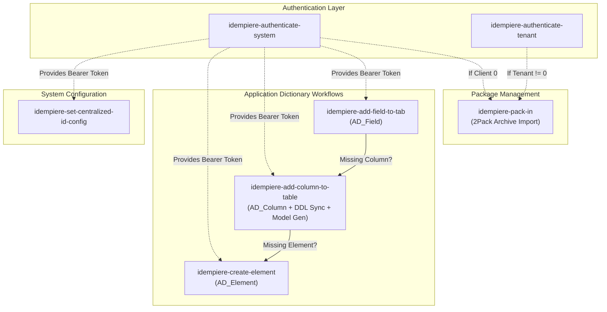
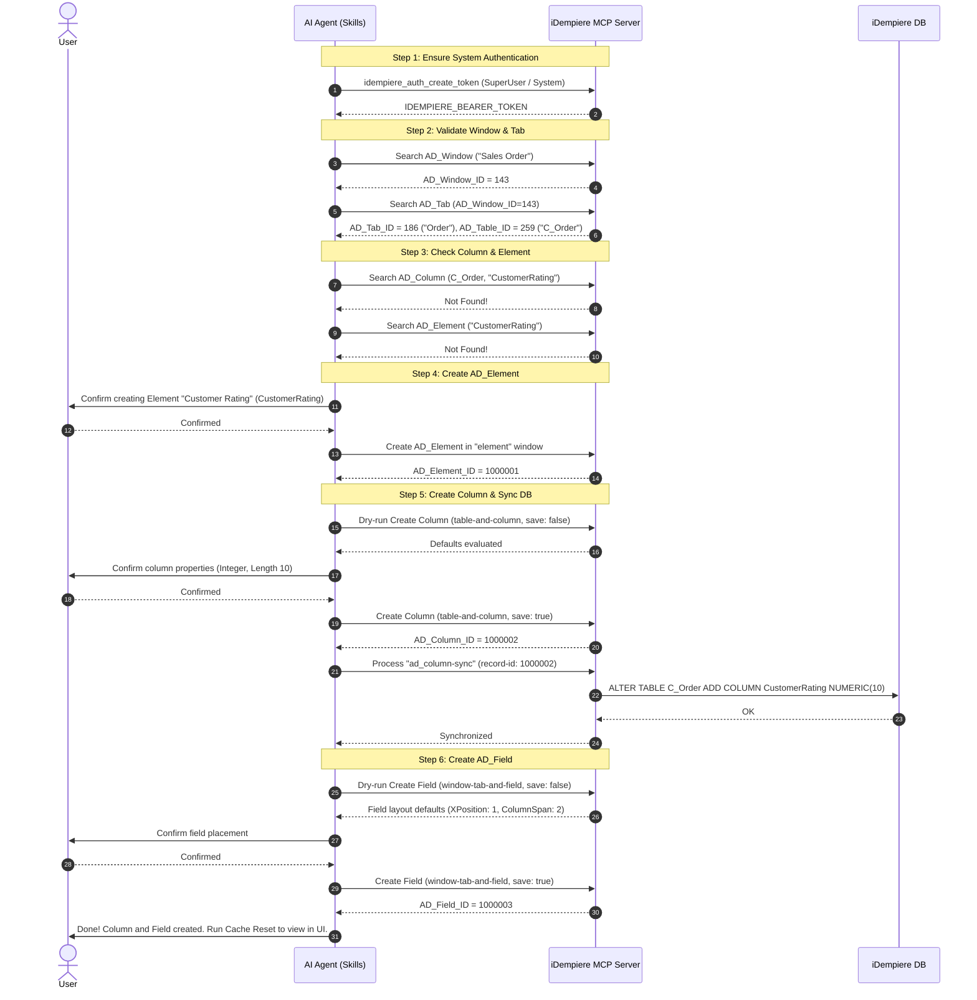

# iDempiere MCP Skills Documentation

This document provides a comprehensive technical guide and reference for the skills located in the [`skills`](./) folder. These skills enable AI coding assistants (such as Google Antigravity, Claude, or custom MCP agents) to interact systematically with [iDempiere ERP](https://www.idempiere.org/) via the [Model Context Protocol (MCP)](https://modelcontextprotocol.io/).

---

## Table of Contents

1. [Overview](#overview)
2. [Skill Catalog & Summary](#skill-catalog--summary)
3. [Architecture & Interaction Workflow](#architecture--interaction-workflow)
4. [Prerequisites & Authentication](#prerequisites--authentication)
5. [Common Options & Conventions](#common-options--conventions)
6. [Detailed Skill Reference](#detailed-skill-reference)
   - [1. `idempiere-authenticate-system`](#1-idempiere-authenticate-system)
   - [2. `idempiere-authenticate-tenant`](#2-idempiere-authenticate-tenant)
   - [3. `idempiere-create-element`](#3-idempiere-create-element)
   - [4. `idempiere-add-column-to-table`](#4-idempiere-add-column-to-table)
   - [5. `idempiere-add-field-to-tab`](#5-idempiere-add-field-to-tab)
   - [6. `idempiere-pack-in`](#6-idempiere-pack-in)
   - [7. `idempiere-set-centralized-id-config`](#7-idempiere-set-centralized-id-config)
7. [Composite Workflows & Orchestration](#composite-workflows--orchestration)
8. [Error Handling & Best Practices](#error-handling--best-practices)

---

## Overview

The iDempiere MCP skills provide guided, deterministic procedures for critical Application Dictionary (AD) maintenance and administration tasks:
- **Authentication**: Managing JWT bearer tokens across System (Tenant 0) and application tenant contexts.
- **Application Dictionary (AD) Engineering**: Creating data elements, adding database columns, synchronizing physical schemas, generating Java model classes, and placing fields on UI window tabs.
- **Package Management**: Importing 2Pack archives (`PackIn`) with attachment handling and client targeting validation.
- **System Configuration**: Configuring centralized sequence IDs and dictionary developer credentials.

---

## Skill Catalog & Summary

| Skill | Directory | Primary Scope | Target Object / Endpoint | Auth Scope |
|---|---|---|---|---|
| [`idempiere-authenticate-system`](./idempiere-authenticate-system/SKILL.md) | `skills/idempiere-authenticate-system` | System Admin Auth | `idempiere_auth_create_token` | System (`Client 0`) |
| [`idempiere-authenticate-tenant`](./idempiere-authenticate-tenant/SKILL.md) | `skills/idempiere-authenticate-tenant` | Tenant / Business Auth | `idempiere_auth_create_token` | Tenant (e.g. GardenWorld) |
| [`idempiere-create-element`](./idempiere-create-element/SKILL.md) | `skills/idempiere-create-element` | Element Definition | `AD_Element` / `element` window | System Admin |
| [`idempiere-add-column-to-table`](./idempiere-add-column-to-table/SKILL.md) | `skills/idempiere-add-column-to-table` | Table Column & DDL | `AD_Column`, `ad_column-sync` | System Admin |
| [`idempiere-add-field-to-tab`](./idempiere-add-field-to-tab/SKILL.md) | `skills/idempiere-add-field-to-tab` | UI Window Tab Field | `AD_Field` / `window-tab-and-field` | System Admin |
| [`idempiere-pack-in`](./idempiere-pack-in/SKILL.md) | `skills/idempiere-pack-in` | 2Pack Zip Import | `AD_Package_Imp_Proc`, `PackIn` | System or Tenant |
| [`idempiere-set-centralized-id-config`](./idempiere-set-centralized-id-config/SKILL.md) | `skills/idempiere-set-centralized-id-config` | SysConfig Credentials | `AD_SysConfig` | System Admin |

---

## Architecture & Interaction Workflow

The skills are modular and frequently chain together. For example, adding a UI field to a window tab can trigger adding a table column, which in turn can trigger creating a missing element.



---

## Prerequisites & Authentication

All non-login MCP tool invocations require authentication.
- **Bearer Token**: The JWT token returned by `idempiere_auth_create_token` must be stored as `IDEMPIERE_BEARER_TOKEN`.
- **Authorization Parameter**: Pass the raw JWT string without the `Bearer ` prefix via the `_authorization_bearer` argument:
  ```json
  {
    "_authorization_bearer": "<IDEMPIERE_BEARER_TOKEN>"
  }
  ```
  *(If the MCP client injects `Authorization: Bearer <token>` in the HTTP headers, the header takes precedence.)*
- **Token Invalidation / Expiration**: When any tool returns a `401 Unauthorized` or token expired error, re-execute the appropriate authentication skill.

---

## Common Options & Conventions

Many Application Dictionary manipulation skills (`idempiere-create-element`, `idempiere-add-column-to-table`, `idempiere-add-field-to-tab`, `idempiere-pack-in`) share the following optional parameters:

| Parameter | Type | Default | Description |
|---|---|---|---|
| `logMigrationScript` | `boolean` | `false` | When `true`, instructs iDempiere to log SQL migration scripts on the server. |
| `adempiereSys` | `boolean` | `false` | Dictionary maintenance mode (`EntityType = 'D'`). Requires centralized dictionary IDs. |
| `migrationScriptComment` | `string` | `""` | Documentation comment logged with the migration script (e.g., ticket ID and feature summary). |

### Field & Naming Conventions
- `Is*` columns are standard `Y`/`N` checkboxes/booleans (e.g. `IsActive`, `IsMandatory`, `IsDisplayed`).
- `*_ID` columns represent primary or foreign keys (e.g. `AD_Element_ID`, `AD_Column_ID`, `AD_Table_ID`).
- `*_UU` columns store record UUIDs (e.g. `$TableName_UU`).
- CamelCase naming is standard for multi-word elements and columns (`CustomerFeedback`, `WhereClause`).

---

## Detailed Skill Reference

---

### 1. `idempiere-authenticate-system`
*File: [`skills/idempiere-authenticate-system/SKILL.md`](./idempiere-authenticate-system/SKILL.md)*

#### Purpose
Authenticates as the System Administrator in Tenant 0 (`Client 0`). Required for Application Dictionary updates, centralized dictionary configuration, and System-level 2Pack imports.

#### Environment Variables & Defaults
| Parameter | Env Variable | Default Value | Notes |
|---|---|---|---|
| `userName` | `IDEMPIERE_ADMINISTRATOR_USER` | `SuperUser` | System user |
| `password` | `IDEMPIERE_ADMINISTRATOR_PASS` | `System` | System user password |
| `roleId` | `IDEMPIERE_ADMINISTRATOR_ROLE` | `0` | System Administrator role ID or Name |
| `clientId` | — | `"0"` | Hardcoded to System client (`"0"`) |
| `organizationId` | — | `"0"` | Hardcoded to `*` organization (`"0"`) |
| `language` | — | `"en_US"` | Default locale |

> **Security Note**: Never print or echo raw passwords or tokens into chat transcripts.

#### MCP Tools Used
- `idempiere_auth_create_token`: Authenticates credentials and returns a JWT token.
- `idempiere_auth_update_token`: Switches role/organization without full re-authentication.
- `idempiere_auth_logout`: Terminates the session.

#### Execution Flow
1. Check if an existing valid token is cached; reuse it if valid.
2. Resolve login variables from environment (treating empty strings as unset).
3. Call `idempiere_auth_create_token`:
   ```json
   {
     "userName": "SuperUser",
     "password": "...",
     "parameters": {
       "clientId": "0",
       "roleId": "0",
       "organizationId": "0",
       "language": "en_US"
     }
   }
   ```
4. Extract `response.token` (never `refresh_token`) and set as `IDEMPIERE_BEARER_TOKEN`.
5. On failure, halt and display the exact error message. Never guess credentials.

---

### 2. `idempiere-authenticate-tenant`
*File: [`skills/idempiere-authenticate-tenant/SKILL.md`](./idempiere-authenticate-tenant/SKILL.md)*

#### Purpose
Authenticates into an application tenant (e.g., GardenWorld) for transactional data operations, tenant-specific model searches, and tenant-level 2Pack imports.

#### Environment Variables & Defaults
| Parameter | Env Variable | Default Value | Notes |
|---|---|---|---|
| `userName` | `IDEMPIERE_TENANT_USER` | `GardenAdmin` | Tenant username |
| `password` | `IDEMPIERE_TENANT_PASS` | `GardenAdmin` | Tenant password |
| `clientId` | `IDEMPIERE_TENANT` | `GardenWorld` | Tenant ID or search key |
| `roleId` | `IDEMPIERE_TENANT_ROLE` | `GardenWorld Admin` | Role ID or Name |
| `organizationId` | `IDEMPIERE_TENANT_ORG` | `"0"` | Default `*` organization |
| `warehouseId` | `IDEMPIERE_TENANT_WAREHOUSE` | `"0"` | `"0"` means no specific warehouse |

#### MCP Tools Used
- `idempiere_auth_create_token`: Generates tenant-scoped JWT token.
- `idempiere_auth_update_token`: Modifies tenant session context.
- `idempiere_auth_logout`: Closes session.

#### Execution Flow
1. Resolve environment variables and defaults.
2. Call `idempiere_auth_create_token` passing `clientId`, `roleId`, `organizationId`, and `warehouseId` as strings.
3. Save `response.token` as `IDEMPIERE_BEARER_TOKEN`.

---

### 3. `idempiere-create-element`
*File: [`skills/idempiere-create-element/SKILL.md`](./idempiere-create-element/SKILL.md)*

#### Purpose
Creates a new reusable metadata element (`AD_Element`) in iDempiere's **Element** window (`element`). Checks for existing elements before creation to avoid duplicate dictionary entries.

#### Inputs
| Property | JSON Field | Mandatory | Description |
|---|---|---|---|
| Name | `Name` | **Yes** | Display label shown to users (e.g., `Customer Feedback`). Must be provided by user. |
| Column Name | `ColumnName` | **Yes** | Physical DB column name (e.g., `XX_CustomerFeedback`). Must be provided by user. |
| Print Name | `PrintName` | No | Short label for reports (defaults to `Name`). |
| Description | `Description` | No | Short descriptive text. |
| Help | `Help` | No | Detailed help text. |
| Entity Type | `EntityType` | No | Entity module type (e.g., `U` for User). |

#### MCP Tools Used
- `idempiere_window_get_records`: Searches existing elements in window `element`.
- `idempiere_window_create_record`: Creates the element in window `element`.

#### Step-by-Step Workflow
1. **Duplicate Check**:
   Query window `element` with filter:
   ```json
   {
     "_authorization_bearer": "<IDEMPIERE_BEARER_TOKEN>",
     "window_name": "element",
     "filter": "ColumnName eq '<ColumnName>'"
   }
   ```
2. **Halt if Exists**:
   If a matching record exists, output the existing record details (`AD_Element_ID`, `Name`, `ColumnName`, `EntityType`, `IsActive`) and stop immediately.
3. **Create Record**:
   If not found, prompt user for confirmation, then create:
   ```json
   {
     "_authorization_bearer": "<IDEMPIERE_BEARER_TOKEN>",
     "window_name": "element",
     "data": {
       "Name": "<Name>",
       "ColumnName": "<ColumnName>",
       "PrintName": "<PrintName>",
       "Description": "<Description>",
       "Help": "<Help>",
       "EntityType": "<EntityType>"
     }
   }
   ```
4. **Report Output**: Return `AD_Element_ID`, `Name`, and `ColumnName`.

---

### 4. `idempiere-add-column-to-table`
*File: [`skills/idempiere-add-column-to-table/SKILL.md`](./idempiere-add-column-to-table/SKILL.md)*

#### Purpose
Adds a new column definition (`AD_Column`) to an existing table, executes the physical database synchronization process (`ad_column-sync`), and optionally creates indexes and re-generates Java POJO model classes.

#### Inputs
- **Mandatory**:
  - `TableName`: Database table name (e.g., `C_Order`).
  - `ColumnName`: Database column name (e.g., `XX_CustomerFeedback`).
- **Common & Optional**:
  - `Reference`: Name of reference (`AD_Reference.Name`, e.g., `String`, `TableDir`, `Amount`, `Yes-No`).
  - `FieldLength`: Column length (e.g., `1`, `10`, `60`).
  - `DefaultValue`: Default SQL/literal value (e.g., `'N'`, `0`).
  - `AD_Reference_Value_ID`: Specific reference list or table validation rule.
  - `IsMandatory`, `IsIdentifier`, `IsSelectionColumn`, `Callout`, `EntityType`.

#### MCP Tools Used
- `idempiere_model_search_records`: Resolves `AD_Element` and `AD_Reference`.
- `idempiere_window_get_records`: Finds the parent table record in window `table-and-column`.
- `idempiere_window_create_child_tab_record`: Adds the child column record (supports dry-run `save: false` and persist `save: true`) and table index.
- `idempiere_process_run`:
  - `ad_column-sync`: Executes DDL to alter/create physical column in PostgreSQL/Oracle.
  - `ad_tableindex-validate`: Validates/creates physical database index.
  - `generatemodel`: Generates Java Model Interface and Class (`X_*` and `M*`).
- `idempiere_model_get_record`: Retrieves `AD_Table` metadata for model generation.

#### Step-by-Step Workflow
1. **Resolve Element**:
   Search `AD_Element` by `ColumnName`. If not found, execute `idempiere-create-element` to create it.
2. **Resolve Reference**:
   Search `AD_Reference` by `Name eq '<Reference>'` to obtain `AD_Reference_ID`.
3. **Find Parent Table**:
   Search window `table-and-column` for `TableName eq '<TableName>'` to obtain `AD_Table_ID`.
4. **Dry-Run Column Creation (`save: false`)**:
   Call `idempiere_window_create_child_tab_record` with `tab_name: "table"`, `child_tab_name: "column"`, and `save: false`.
   > **Important**: Do NOT include `ColumnName` directly in `data` — it is derived from `AD_Element_ID`.
5. **Confirm and Persist (`save: true`)**:
   Display evaluated defaults and callouts to the user. Upon confirmation, execute save and capture `AD_Column_ID`.
6. **Synchronize Column (DDL)**:
   Invoke process `ad_column-sync` with `record-id: <AD_Column_ID>`. Halt if process returns an error.
7. **Optional Index**:
   If requested, create child record under `table-index` with `index-column` entries, then run `ad_tableindex-validate`.
8. **Optional Model Generation**:
   If requested, invoke `generatemodel` process with `TableLike=<TableName>`, `TableEntityType=<EntityType>`, target directory, and package name.

---

### 5. `idempiere-add-field-to-tab`
*File: [`skills/idempiere-add-field-to-tab/SKILL.md`](./idempiere-add-field-to-tab/SKILL.md)*

#### Purpose
Adds a visual field (`AD_Field`) to a window tab (`AD_Tab`) within the `Window, Tab & Field` window (`window-tab-and-field`).

#### Inputs
- **Mandatory**:
  - `WindowName`: Window name (`AD_Window.Name`, e.g., `Sales Order`).
  - `TabName` or `TabIndex`: Target tab name or 0-based tab index sorted by `SeqNo`.
  - `ColumnName`: Database column name (`AD_Column.ColumnName`).
- **Defaults**:
  - `XPosition`: `1` (Left column).
  - `ColumnSpan`: `2` (Full-width spanning 2 layout columns).
- **Optional**:
  - `SeqNo`, `SeqNoGrid`, `IsDisplayed`, `IsDisplayedGrid`, `IsReadOnly`, `IsSameLine`, `DisplayLogic`, `ReadOnlyLogic`, `MandatoryLogic`, `EntityType`.

#### MCP Tools Used
- `idempiere_model_search_records`: Resolves `AD_Window`, `AD_Tab`, `AD_Column`, and checks for existing `AD_Field`.
- `idempiere_model_get_record`: Looks up table identifier if adding a missing column.
- `idempiere_window_create_child_tab_record`:
  - `window_name`: `window-tab-and-field`
  - `tab_name`: `tab`
  - `child_tab_name`: `field`
  - Dry run with `save: false` followed by user confirmation and `save: true`.

#### Step-by-Step Workflow
1. **Validate Window**:
   Search `AD_Window` for `Name eq '<WindowName>' and IsActive eq true`. Escape any single quotes.
2. **Validate & Resolve Tab**:
   Search `AD_Tab` for `AD_Window_ID eq <AD_Window_ID> and IsActive eq true` with `limit: 100`.
   Sort results by `SeqNo` ascending. Resolve `TabName` or 0-based `TabIndex`. Extract `AD_Tab_ID` and `AD_Table_ID`.
3. **Validate Column**:
   Search `AD_Column` for `AD_Table_ID eq <AD_Table_ID> and ColumnName eq '<ColumnName>'`.
   - If missing, offer to invoke `idempiere-add-column-to-table`.
4. **Duplicate Field Check**:
   Search `AD_Field` for `AD_Tab_ID eq <AD_Tab_ID> and AD_Column_ID eq <AD_Column_ID>`. Halt if any record exists.
5. **Dry-Run Creation (`save: false`)**:
   Call `idempiere_window_create_child_tab_record` with `XPosition: 1`, `ColumnSpan: 2` (or user overrides). Show resulting field configuration to the user.
6. **Save Record (`save: true`)**:
   Merge writable values from dry-run response with user overrides (excluding read-only fields like `AD_Field_ID`). Persist the record.
7. **Cache Notification**:
   Remind user that the new field will appear in the web UI after resetting the iDempiere cache (`Cache Reset` process) or re-logging in.

---

### 6. `idempiere-pack-in`
*File: [`skills/idempiere-pack-in/SKILL.md`](./idempiere-pack-in/SKILL.md)*

#### Purpose
Imports a 2Pack packaging zip archive into iDempiere via the **Pack In** window (`pack-in`) and process (`PackIn`).

#### Inputs
- **Mandatory**:
  - `ArchiveFile`: Absolute path to the 2Pack zip file on disk (e.g., `/workspace/2Pack_1.0.0.zip`).
- **Optional Execution Options**:
  - `AD_Override_Dict`: Update system-maintained Application Dictionary (`true`/`false`, default `false`).
  - `logMigrationScript`, `adempiereSys`, `migrationScriptComment`.

#### MCP Tools Used
- `idempiere_model_create_record` (or window `pack-in`): Creates `AD_Package_Imp_Proc` tracking record.
- `idempiere_model_add_record_attachment`: Attaches local zip archive to `AD_Package_Imp_Proc`.
- `idempiere_process_run`: Runs the `PackIn` process (`record_id` must be an integer).
- `idempiere_model_search_records`: Queries `AD_Package_Imp` and `AD_Package_Imp_Detail` for post-import verification and troubleshooting.

#### Step-by-Step Workflow
1. **Archive Validation**:
   - Verify file existence on disk.
   - Run zip inspection to check for valid descriptor:
     ```bash
     unzip -Z1 "<ArchiveFile>" | grep -E "^[^/]+/dict/PackOut\.(xml|json|yaml)$"
     ```
   - Check `Client` attribute in `PackOut.*`:
     - If client starts with `0-`, require System tenant auth (`idempiere-authenticate-system`).
     - If non-zero client ID, require tenant auth (`idempiere-authenticate-tenant`).
2. **Create Package Import Record**:
   Create record in `AD_Package_Imp_Proc` with package name:
   ```json
   {
     "model": "AD_Package_Imp_Proc",
     "data": {
       "Name": "2Pack_1.0.0.zip",
       "AD_Override_Dict": false
     }
   }
   ```
   Capture `AD_Package_Imp_Proc_ID`.
3. **Upload Archive Attachment**:
   Call `idempiere_model_add_record_attachment`:
   ```json
   {
     "tableName": "AD_Package_Imp_Proc",
     "record_id": "<AD_Package_Imp_Proc_ID>",
     "data": "<ArchiveFile>"
   }
   ```
4. **Execute PackIn Process**:
   Call `idempiere_process_run`:
   ```json
   {
     "process_value": "PackIn",
     "record_id": <AD_Package_Imp_Proc_ID>
   }
   ```
5. **Verify Outcome**:
   Check `isError` flag and `summary` text. Note that HTTP 200 may still contain `isError: true` or unresolved counts (`Un-Resolved=...`). Query `AD_Package_Imp_Detail` if errors occurred.

---

### 7. `idempiere-set-centralized-id-config`
*File: [`skills/idempiere-set-centralized-id-config/SKILL.md`](./idempiere-set-centralized-id-config/SKILL.md)*

#### Purpose
Configures the official centralized sequence ID credentials in `AD_SysConfig` (`DICTIONARY_ID_USER` and `DICTIONARY_ID_PASSWORD`). Used by core developers and official plugin authors to avoid ID collisions across iDempiere versions.

#### Environment Variables
| Setting | Primary Variable | Fallback Variable | Description |
|---|---|---|---|
| Centralized ID User | `IDEMPIERE-CENTRALIZED-ID-USER` | `IDEMPIERE_CENTRALIZED_ID_USER` | Registered centralized ID username |
| Centralized ID Password | `IDEMPIERE-CENTRALIZED-ID-PASS` | `IDEMPIERE_CENTRALIZED_ID_PASS` | Centralized ID sequence password |

#### MCP Tools Used
- `idempiere_model_search_records`: Finds `AD_SysConfig` records for `DICTIONARY_ID_USER` and `DICTIONARY_ID_PASSWORD`.
- `idempiere_model_update_record`: Updates the `Value` field for both configuration records.

#### Step-by-Step Workflow
1. **Resolve Credentials**:
   Read environment variables. If either is unset or blank, ask user for the credentials. Never guess.
2. **Query SysConfig IDs**:
   Search `AD_SysConfig`:
   ```json
   {
     "model": "AD_SysConfig",
     "filter": "Name eq 'DICTIONARY_ID_USER' or Name eq 'DICTIONARY_ID_PASSWORD'"
   }
   ```
3. **Update Values**:
   Update `DICTIONARY_ID_USER` and `DICTIONARY_ID_PASSWORD` via `idempiere_model_update_record`.
4. **Report**:
   Confirm updates to the user without disclosing the plain-text password in logs or responses.

---

## Composite Workflows & Orchestration

### End-to-End Example: Adding a Complete New UI Field from Scratch

When a developer asks: *"Add a Customer Rating column and field to the Sales Order window"*:



---

## Error Handling & Best Practices

1. **Dry-Run Validation First**:
   Always execute `save: false` via `idempiere_window_create_child_tab_record` before persisting records. This lets iDempiere callouts and default logic calculate fields, and catches validation issues prior to writing to the database.
2. **Never Send `ColumnName` in Child Tab Column Data**:
   When creating a record in `table-and-column` (`column` child tab), provide `AD_Element_ID` and `AD_Reference_ID`. Omitting `ColumnName` is required because iDempiere sets `ColumnName` automatically from the element.
3. **Foreign Key Object Handling**:
   The iDempiere REST API often serializes foreign keys as compound objects (e.g. `{"id": 259, "identifier": "C_Order"}`). Always parse and use the numeric `.id` for OData query filters.
4. **OData Filter Escaping**:
   Single quotes inside names (e.g., `Customer's Order`) must be doubled (`''`) when formatting filter expressions.
5. **Tab Sequencing**:
   Never rely on array indexing from `AD_Tab` search responses. Always sort the returned tab records by `SeqNo` ascending to accurately resolve 0-based tab indices.
6. **2Pack Client Matching**:
   Always verify the `Client` entry inside `PackOut.*` before running `PackIn`. Running a tenant package in System (or vice-versa) triggers a runtime failure inside `PackInHandler`.
7. **Cache Invalidation**:
   Application Dictionary UI modifications (`AD_Field`, `AD_Tab`, `AD_Window`) are cached in memory by the iDempiere Application Server. Remind users to run the **Cache Reset** process or re-login to see changes.
